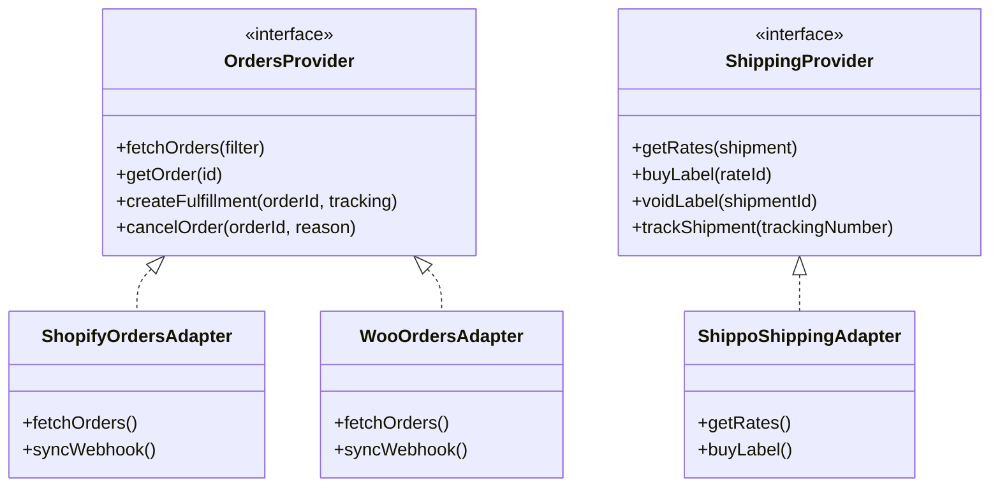

# Storefront Ops Architecture

## 1. Monorepo Organization & Boundaries

```
storefront-ops/
├── apps/
│   └── web/                   # Next.js 15 (App Router), Tailwind CSS, shadcn/ui, TanStack Table
├── packages/
│   ├── core/                  # Pure business logic (money, stock math, order transitions)
│   ├── integrations/          # Decoupled adapters (Shopify, Woo, Stripe, Shippo, Resend)
│   ├── db/                    # PostgreSQL migrations, schema, RLS, and generated types
│   ├── ui/                    # Reusable primitives, design tokens, status pill configs
│   ├── jobs/                  # Background worker queue definitions (Inngest)
│   └── config/                # Shared linting, tsconfig, and styling presets
└── docs/                      # PRD, Playbook, Spec, Decisions, Architecture
```

### Dependency Rules:
1. `packages/core` has **ZERO** framework dependencies. It can be run anywhere (Node, browser, edge workers) and holds pure, testable domain rules.
2. `packages/integrations` implements adapter interfaces defined in `core` or `integrations`. UI components **never** directly invoke vendor SDKs.
3. `apps/web` consumes `packages/core`, `packages/integrations`, and `packages/ui`.
4. `packages/db` owns the schema truth and database migrations.

---

## 2. Core Adapter Interfaces



---

## 3. Strict Inventory Math & State Transition Engine
- **Available-to-Promise Rule**:
  $$\text{Available} = \text{On Hand} - \text{Committed}$$
- **Ledger Rule**: Every unit increment or decrement MUST be accompanied by an append-only row in `inventory_movements`.
- **Order State Machine**:
  - `pending_payment` $\rightarrow$ `paid` | `cancelled`
  - `paid` $\rightarrow$ `ready_to_pack` | `on_hold` | `cancelled`
  - `ready_to_pack` $\rightarrow$ `packing` $\rightarrow$ `packed` $\rightarrow$ `shipped` $\rightarrow$ `delivered`
  - Any non-final state $\rightarrow$ `cancelled` (with restock options)
