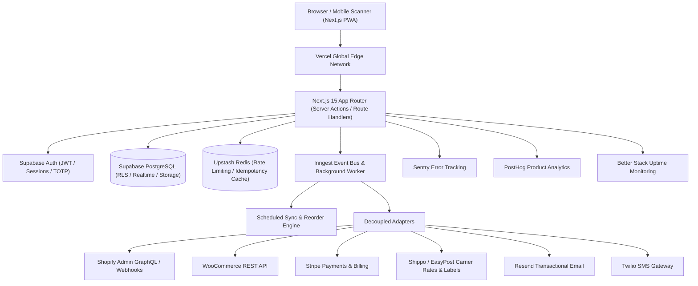

# Storefront Ops Infrastructure & Environment Architecture

## 1. System Infrastructure Architecture



---

## 2. Environments Topology

| Dimension | Dev (Local) | Staging | Production |
| :--- | :--- | :--- | :--- |
| **Hosting** | `localhost:3000` | `staging.storefrontops.com` (Vercel Preview) | `app.storefrontops.com` (Vercel Production) |
| **Public API** | `localhost:3000/api/v1` | `api-staging.storefrontops.com` | `api.storefrontops.com` |
| **Status Page** | N/A | `status-staging.storefrontops.com` | `status.storefrontops.com` (Better Stack) |
| **PostgreSQL / Auth** | Local Supabase Docker / Direct PG | Dedicated Supabase Staging Project | Dedicated Supabase Production Project |
| **Database Branching** | Ephemeral feature branches | Staging branch (re-seedable on demand) | Production (Point-in-Time Recovery enabled) |
| **Background Jobs** | Inngest Local Dev Server (`npx inngest-cli dev`) | Inngest Staging Cloud | Inngest Production Cloud |
| **Redis Cache** | Local Redis / Upstash Dev | Upstash Staging | Upstash Production |
| **Stripe Gateway** | Test Mode (`sk_test_...`) | Test Mode (`sk_test_...`) | Live Mode (`sk_live_...`) |
| **Email Delivery** | Local Console Preview / Resend Test | Resend Staging (`staging@yourdomain.com`) | Resend Production (`notifications@yourdomain.com`) |

---

## 3. Environment Variables Matrix

| Variable Name | Description | Environment | Storage Location | Sensitivity |
| :--- | :--- | :--- | :--- | :--- |
| `NODE_ENV` | Runtime environment (`development`, `test`, `production`) | All | System / Vercel | Public |
| `NEXT_PUBLIC_APP_URL` | Canonical app URL | All | `.env` / Vercel | Public |
| `NEXT_PUBLIC_SUPABASE_URL` | Supabase project endpoint | All | `.env` / Vercel | Public |
| `NEXT_PUBLIC_SUPABASE_ANON_KEY`| Client-safe Supabase anonymous key | All | `.env` / Vercel | Public |
| `SUPABASE_SERVICE_ROLE_KEY` | Server-only administrative database access | All | Supabase Vault / Vercel Secret | **Confidential** |
| `DATABASE_URL` | Direct connection string for migrations & pooler | All | Supabase / Vercel Secret | **Confidential** |
| `UPSTASH_REDIS_REST_URL` | Redis endpoint for rate limiting | Staging / Prod | Vercel Secret | Confidential |
| `UPSTASH_REDIS_REST_TOKEN` | Redis auth token | Staging / Prod | Vercel Secret | **Confidential** |
| `INNGEST_EVENT_KEY` | Inngest event emission key | All | Vercel Secret | Confidential |
| `INNGEST_SIGNING_KEY` | Inngest webhook signature verification key | Staging / Prod | Vercel Secret | **Confidential** |
| `STRIPE_SECRET_KEY` | Stripe backend API key | All | Vercel Secret | **Confidential** |
| `STRIPE_WEBHOOK_SECRET` | Stripe webhook signing secret | All | Vercel Secret | **Confidential** |
| `NEXT_PUBLIC_STRIPE_PUBLISHABLE_KEY` | Client-side Stripe Elements key | All | `.env` / Vercel | Public |
| `SHIPPO_API_TOKEN` | Shipping label aggregator API token | All | Vercel Secret | **Confidential** |
| `RESEND_API_KEY` | Transactional email API key | All | Vercel Secret | **Confidential** |
| `TWILIO_ACCOUNT_SID` | SMS account identifier | Staging / Prod | Vercel Secret | Confidential |
| `TWILIO_AUTH_TOKEN` | SMS auth token | Staging / Prod | Vercel Secret | **Confidential** |
| `NEXT_PUBLIC_SENTRY_DSN` | Client/server error reporting DSN | Staging / Prod | Vercel | Public |
| `NEXT_PUBLIC_POSTHOG_KEY` | Product telemetry key | Staging / Prod | Vercel | Public |

---

## 4. Secret Management & Key Rotation Procedure

1. **Storage Rules**:
   - Zero secrets committed to git. `.env.example` provides the schema blueprint with placeholder values.
   - Production secrets exist strictly in Vercel Project Settings (Encrypted Environment Variables) and Supabase Vault.
2. **Rotation Steps (e.g. Stripe, Resend, Shippo)**:
   - Generate a secondary API key in the provider dashboard.
   - Update the secret in Vercel and Supabase Vault.
   - Trigger an immediate redeployment of `app.storefrontops.com`.
   - Verify health via `/api/v1/health` and a test transaction.
   - Revoke the old key in the provider dashboard.
3. **Database Credentials**:
   - Rotated through Supabase Dashboard with automatic connection string rollover.

---

## 5. Developer Onboarding (1-Page Quickstart)

### Prerequisites:
- Node.js >= 20.0.0
- Git

### Steps:
1. **Clone the repository**:
   ```bash
   git clone <repo-url>
   cd E-Commerce
   ```
2. **Configure environment variables**:
   ```bash
   cp .env.example .env.local
   ```
3. **Run database migrations & seed reference data**:
   ```bash
   npm run db:migrate
   npm run db:seed
   ```
4. **Run core tests**:
   ```bash
   npm test
   ```
5. **Start the development server**:
   ```bash
   npm run dev
   ```
   Open [http://localhost:3000](http://localhost:3000) in your browser.
